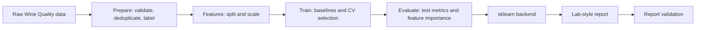
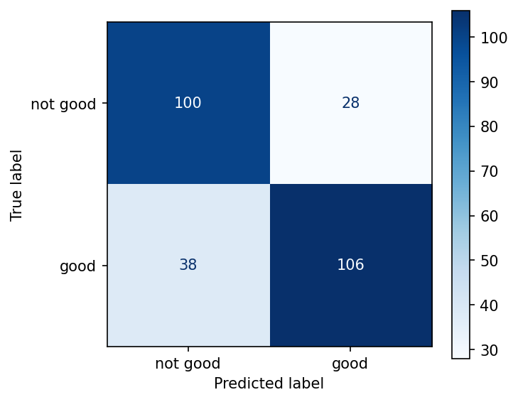
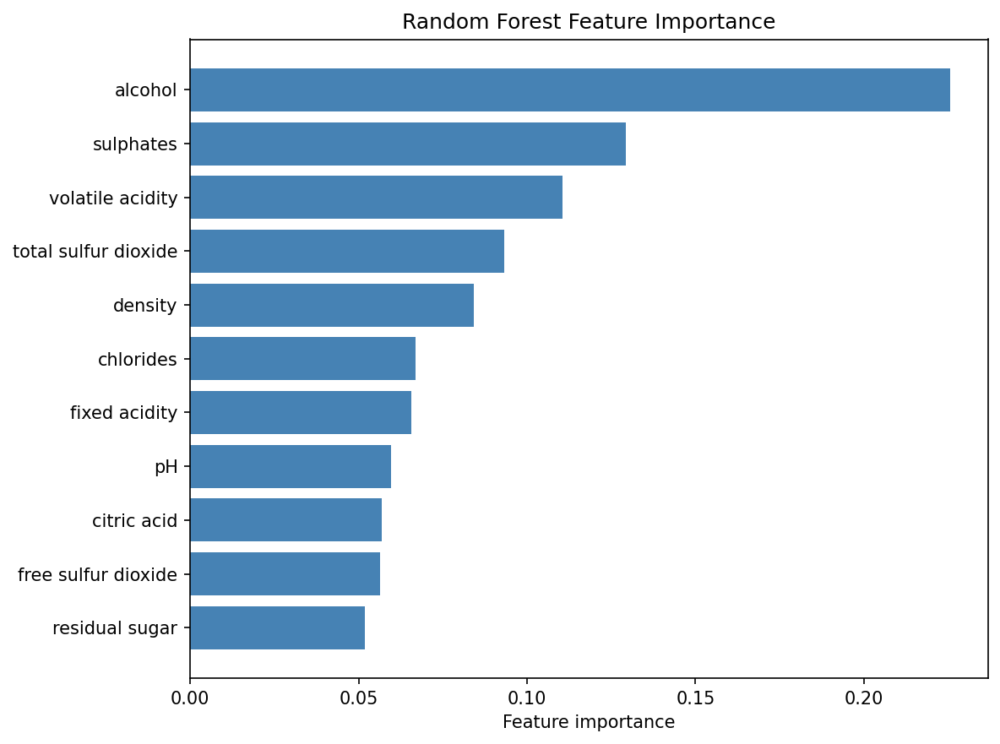

[](https://github.com/jaggu1873/smart-laboratory-report-generator/actions/workflows/ci.yml)

# Smart Laboratory Report Generator

## Overview

Smart Laboratory Report Generator is an MLOps project that transforms
loosely-structured experiment data into structured, validated laboratory
reports. It combines a deterministic Python report foundation with a retained
legacy Wine Quality baseline and an active UCI hydraulic condition-monitoring
pipeline for cycle-level feature extraction, evaluation, tracking, and report
generation.

This README distinguishes the verified Phase 1 MLOps implementation from
future AI/report-generation work. Course-specific approval of the selected
dataset is not asserted here.

## Problem Statement

Laboratory experiment records are often captured as free-form, inconsistent
notes: mixed units, missing sections, ambiguous field names, and no guarantee
of structural completeness. Turning these into reliable, comparable reports is
manual, error-prone, and hard to reproduce. There is a need for a system that:

- normalizes heterogeneous raw input into a consistent structure,
- generates a complete laboratory report,
- validates the report deterministically, and
- does all of this in a **reproducible, versioned, and trackable** way suitable
  for an ML lifecycle.

## Project Objectives

1. Provide a clean, deterministic foundation for ingesting and validating
   laboratory experiment data.
2. Establish reproducible MLOps practices: version control, data versioning,
   and experiment tracking.
3. Introduce data-driven components (EDA, feature engineering, baseline models)
   in a structured Phase 1.
4. Evolve toward an AI-assisted report generator built on a pluggable model
   backend, without rewriting the surrounding pipeline.
5. Keep the system testable, reproducible, and academically documented at every
   phase.

## Run the Project Locally

This repository currently provides a command-line Python workflow, not a
graphical application. Use Python 3.10, the version exercised by CI and the
pinned dependencies. From Windows PowerShell:

```powershell
git clone https://github.com/jaggu1873/smart-laboratory-report-generator.git
cd smart-laboratory-report-generator
git switch feature/gas-sensor-migration
py -3.10 -m venv .venv
.\.venv\Scripts\python.exe -m pip install --upgrade pip
.\.venv\Scripts\python.exe -m pip install -r requirements.txt
```

Download and prepare the official UCI Condition Monitoring of Hydraulic
Systems dataset (DOI `10.24432/C5CW21`). The setup script checks a pinned
SHA-256, ZIP CRCs, exact member names and sizes, and safe extraction paths.
The archive is about 77 MB; extracted sensor files total about 556 MB. Data is
not downloaded during imports or tests.

```powershell
.\.venv\Scripts\python.exe scripts\setup_hydraulic_dataset.py
```

A saved Random Forest comparison is included as a small example. This command
generates and validates a report for cycle 2006:

```powershell
.\.venv\Scripts\python.exe -m src.hydraulic.report `
  --comparison-id hydraulic-compare-20261021-2104d `
  --candidate random_forest `
  --cycle-id 2006
```

The JSON is written to
`reports/hydraulic/comparisons/hydraulic-compare-20261021-2104d/cycle_2006_random_forest_report.json`.
Existing report files are never overwritten. To train and evaluate a fresh,
isolated run, use a new run ID:

```powershell
.\.venv\Scripts\python.exe -m src.hydraulic.train --run-id friend-hydraulic-run-01
.\.venv\Scripts\python.exe -m src.hydraulic.evaluate --run-id friend-hydraulic-run-01
.\.venv\Scripts\python.exe -m src.hydraulic.report `
  --run-id friend-hydraulic-run-01 `
  --cycle-id 2006
```

Start the local MLflow UI from the repository root. Keep it running in one
PowerShell window and run training or comparison commands in another:

```powershell
mlflow ui --backend-store-uri sqlite:///mlflow.db --host 127.0.0.1 --port 5000
```

Open `http://127.0.0.1:5000`. A new clone creates its own ignored `mlflow.db`
and `mlruns/` artifacts. A fresh multi-model comparison logs to the
`hydraulic-condition-monitoring` experiment and keeps validation metrics
separate from the locked chronological test metrics:

```powershell
.\.venv\Scripts\python.exe -m src.hydraulic.comparison `
  --comparison-id friend-hydraulic-comparison-01 `
  --random-state 42
```

Run the project tests and hydraulic compilation check:

```powershell
.\.venv\Scripts\python.exe -m unittest discover -s tests -v
.\.venv\Scripts\python.exe -m unittest discover -s model\tests -v
.\.venv\Scripts\python.exe -m compileall -q src\hydraulic tests
```

If the pipeline reports a missing `profile.txt` or sensor matrix, run the
dataset setup command again and confirm the download completed. If
`py -3.10` is unavailable, install Python 3.10 and enable the Python launcher.
You may activate the environment with `.\.venv\Scripts\Activate.ps1` to use
short `python` and `mlflow` commands. The deterministic mock report backend
works offline without an API key or paid service; hydraulic reports use the
saved sklearn pipeline.

## Legacy Wine Quality Workflow

The original Phase 1 baseline used the red-wine subset of the Wine Quality
dataset. Its source, DVC pipeline, models, and reports remain as legacy
project material. Active hydraulic model comparison and MLflow tracking use
the UCI Condition Monitoring of Hydraulic Systems dataset; the Wine workflow
is no longer an MLflow experiment-tracking path.

See [MODEL_CARD.md](MODEL_CARD.md) for the legacy Wine classifier, its
evaluation, intended use, and limitations.

Current Phase 1 working structure:

```
data/raw/winequality-red.csv   legacy Wine source (DVC pointer retained)
data/processed/                DVC-prepared, split, and scaled datasets
notebooks/01_eda.ipynb         initial exploratory analysis
reports/figures/               DVC-managed notebook and evaluation figures
src/                            DVC prepare, feature, train, and evaluate scripts
models/                         selected sklearn model and run metadata
metrics/                        final evaluation metrics
scripts/demo_report.py          validated sklearn report example
.github/workflows/ci.yml         test, lint, and source-compilation jobs
params.yaml                    legacy Wine data, split, and model parameters
requirements.txt               pinned Phase 1 dependencies
model/                         existing deterministic report-generator package
```

The legacy Wine preparation and evaluation stages remain available. The
active hydraulic pipeline uses a separately downloaded official UCI archive;
no shared DVC remote is configured for a fresh clone.

## Proposed ML / MLOps Lifecycle

The project follows a standard MLOps lifecycle, adapted to an academic,
phase-based delivery:

```
Data acquisition → EDA → Feature engineering → Baseline models
      → Experiment tracking (MLflow) + Data versioning (DVC)
      → Model evaluation → Model integration (backend)
      → Report generation → Validation → Iteration
```

Reproducibility (Git, DVC, MLflow) is treated as a first-class concern that
wraps the entire lifecycle rather than a final step.



## Phase 1 – Development & Reproducibility

Phase 1 covers the dataset, analysis, baseline modeling, reproducibility, and
report-inference work verified in this repository. Course-specific dataset
approval remains outside the repository.

### 1. Wine Quality dataset — *Completed*
The UCI Wine Quality red-wine source CSV is tracked with DVC. Course-specific
dataset approval should be confirmed separately; it is not asserted here.

### 2. Data exploration (EDA) — *Completed*
The executed EDA notebook documents data quality, target balance, feature
distributions, outliers, and correlations, and saves figures under
`reports/figures/`.

### 3. Feature engineering — *Completed*
The prepare stage removes duplicates and derives `good`; the features stage
creates a stratified split and scales using training data only.

### 4. Baseline models — *Completed*
Dummy, logistic-regression, and random-forest baselines were historically
logged to MLflow. Those Wine runs have been removed from the active tracking
store; the legacy scripts still train and evaluate locally but do not write
MLflow runs. The winning model is selected using training-only cross-validation F1.

### 5. Git repository — *Completed*
The project is under Git version control and hosted on GitHub. DVC metadata
for the legacy Wine stages is retained, but there is no shared DVC remote.

### 6. DVC dataset versioning — *Legacy workflow*
The Wine source and pipeline metadata remain tracked with DVC, but no shared
DVC remote is configured. A fresh clone cannot retrieve that data with
`dvc pull` unless the user configures an accessible remote. The active
hydraulic pipeline uses the checksum-verified UCI setup script instead.

### 7. MLflow experiment tracking — *Hydraulic active*
MLflow tracks hydraulic comparison candidates, split-specific metrics,
provenance, thresholds, model artifacts, and comparison summaries. Wine
Quality history was removed from the active store after a verified backup;
the Wine DVC and local training workflow remain separate and do not log runs.

### 8. Initial model evaluation — *Completed*
The selected classifier is evaluated on the held-out test set. Metrics are
written to `metrics/metrics.json` and the confusion matrix to
`reports/figures/confusion_matrix.png`.

### 9. sklearn backend — *Completed*
The optional backend loads the trained classifier and scaler, maps named
measurements into training feature order, and reports missing inputs without
raising an error.

## Current Implementation Status

The table below reflects the actual state of the repository.

| Component | Status |
|---|---|
| Git/GitHub | Completed |
| Core Python model foundation | Completed |
| Unit normalization | Completed |
| Deterministic validation | Completed |
| Wine Quality dataset | Legacy; source DVC pointer retained |
| EDA | Completed |
| Feature engineering | Completed |
| Baseline ML models | Completed |
| DVC | Legacy Wine metadata; no shared remote configured |
| MLflow | Active hydraulic tracking; Wine history migrated |
| Initial Wine model evaluation | Legacy |
| sklearn backend | Completed |
| Real LLM backend | Future |
| PDF/report export | Future |

What exists and works today (the implemented model foundation):

- **Preprocessing** — normalizes loosely-structured raw input into a consistent
  `ExperimentInput` (whitespace collapsing, unit canonicalization).
- **Structured schemas** — dataclass contracts shared across all pipeline
  stages.
- **Pluggable `ModelBackend`** — a single interface that decouples the pipeline
  from any specific model.
- **`MockModelBackend`** — a deterministic, offline backend requiring no API key
  or network access.
- **Report generation** — orchestrated assembly of a `LabReport` from an
  experiment input.
- **Deterministic validation** — structural and data-level checks with no model
  calls (required sections, non-empty fields, finite numeric values, recognized
  units, no duplicate measurements).
- **Centralized unit registry** — one source of truth for canonical units and
  aliases, shared by normalization and validation.
- The report foundation and Wine pipeline retain their existing regression
  tests; hydraulic pipeline tests are in `tests/test_hydraulic_pipeline.py`.

## Current Architecture

The `model` package is organized into focused, single-responsibility modules:

| Module | Responsibility |
|---|---|
| `model/schemas.py` | Dataclass contracts shared across pipeline stages. |
| `model/units.py` | Central registry of canonical units and their aliases. |
| `model/preprocessing.py` | Cleans and normalizes raw input into `ExperimentInput`. |
| `model/inference.py` | `ModelBackend`, default `MockModelBackend`, and optional `SklearnModelBackend`. |
| `model/generator.py` | Orchestrates preprocessing, generation, and assembly. |
| `model/validator.py` | Deterministic structural and data validation. |
| `model/config.py` | Environment-driven configuration; reads API keys at call time. |

Data flows in one direction:

```
raw dict → preprocess() → ExperimentInput → LabReportGenerator → LabReport → validate_report() → ValidationResult
```

Configuration is read from environment variables via `ModelConfig.from_env()`,
with safe defaults so the mock backend runs with no setup. API keys are read
fresh from the environment at call time and are never hardcoded or cached on
config objects.

## Hydraulic condition-monitoring pipeline

The hydraulic pipeline is an independent package under `src/hydraulic/`. It
does not replace or alter the retained Wine data, DVC stages, models, or
reports. See the [hydraulic pipeline guide](docs/hydraulic_pipeline.md)
for source provenance, dataset validation, feature definitions, split design,
metrics, limitations, and exact reproduction commands.

The audited UCI files are read in place from
`data/inspection/uci-hydraulic-condition-monitoring/extracted/`. Outputs are
written into unique run-specific hydraulic directories beneath
`data/processed/hydraulic/`, `models/hydraulic/`, `metrics/hydraulic/`, and
`reports/hydraulic/`. The input profile targets are stored separately and are
never model features.

MLflow tracking now uses the `hydraulic-condition-monitoring` experiment.
Comparison runs use saved candidate estimators and metrics, and tag validation
results separately from the locked chronological test results. See the
[hydraulic MLflow guide](docs/hydraulic_mlflow.md) for URI configuration,
comparison logging, run inspection, and local database setup.

### Quick start (current foundation)

```python
from model import LabReportGenerator, ModelConfig, preprocess, validate_report

raw = {
    "title": "Boiling Point of Water",
    "objective": "determine the boiling point of water at sea level",
    "materials": ["beaker", "thermometer", "hot plate"],
    "procedure": ["Fill beaker", "Heat until boiling", "Record temperature"],
    "measurements": [
        {"name": "temperature", "value": 99.8, "unit": "Celsius"},
        {"name": "volume", "value": 250, "unit": "ml"},
    ],
}

experiment = preprocess(raw)
generator = LabReportGenerator(config=ModelConfig(backend="mock"))
report = generator.generate_from_input(experiment)
result = validate_report(report)
```

## MLOps Lifecycle Mapping

| Stage | Tool | File or artifact |
|---|---|---|
| Legacy dataset pointer | DVC | `data/raw/winequality-red.csv.dvc` (no shared remote) |
| EDA | Jupyter, pandas, seaborn | `notebooks/01_eda.ipynb`, `reports/figures/` |
| Prepare label and deduplicate | pandas, DVC | `src/prepare.py`, `data/processed/clean.csv` |
| Split and scale | scikit-learn, DVC | `src/features.py`, `data/processed/train.csv`, `data/processed/test.csv`, `data/processed/scaler.joblib` |
| Legacy Wine baseline training and selection | scikit-learn | `src/train.py`, `params.yaml`, `models/best_model.joblib`, `models/best_run.json` |
| Hydraulic comparison tracking | scikit-learn, MLflow | `src/hydraulic/comparison.py`, `src/hydraulic/mlflow_tracking.py`, `mlflow.db` |
| Final evaluation | scikit-learn, DVC | `src/evaluate.py`, `metrics/metrics.json`, `metrics/feature_importance.csv`, `reports/figures/confusion_matrix.png`, `reports/figures/feature_importance.png` |
| Report inference | `ModelBackend`, scikit-learn | `model/inference.py`, `scripts/demo_report.py` |
| Report validation | deterministic validator | `model/validator.py` |

## Model Card

See [`MODEL_CARD.md`](MODEL_CARD.md) for model details, intended use,
evaluation, and limitations.

## Baseline Results

The following table is a retained **pre-migration Wine baseline snapshot**.
These historical values are documented from the old MLflow runs and are no
longer read from the active tracking database. Wine test F1 did not select the
winner; selection used training-only cross-validation F1.

| Run | CV F1 mean | Test F1 |
|---|---:|---:|
| dummy-most-frequent | 0.6919 | 0.6923 |
| logistic-regression-c-0.1 | 0.7520 | 0.7402 |
| logistic-regression-c-1.0 | 0.7550 | 0.7447 |
| logistic-regression-c-10.0 | 0.7549 | 0.7447 |
| random-forest-100-depth-5 | 0.7622 | 0.7714 |
| random-forest-200-depth-10 | **0.7642** | 0.7626 |
| random-forest-300-unlimited-depth | 0.7631 | 0.7687 |

The following Git-tracked images are legacy Wine figures copied from
`reports/figures/`:





## Legacy Wine Workflow

The retained Wine stages remain in `dvc.yaml`, but no shared DVC remote is
configured and a fresh clone cannot retrieve their DVC-managed files. They are
not required for the active hydraulic workflow. Do not run `dvc pull` unless
you have configured your own accessible remote.

## Limitations

The Wine Quality data is a legacy proxy dataset, not a dataset of laboratory
reports. Hydraulic evaluation uses sequential observations from one rig, has
operating-condition shifts, and lacks independent run/rig identifiers. Its
retrospective scores do not establish production readiness or independent-run
generalization. Report sections are structured and validated, not generated
or scientifically certified by an LLM.

## Future AI / Report-Generation Architecture

The current architecture already anticipates an AI-assisted generator: the
pipeline depends only on the `ModelBackend` interface, so a real model can be
introduced without touching preprocessing, generation, or validation.

**Future** work (beyond Phase 1) includes:

- A **real LLM backend** implementing `ModelBackend` alongside the mock and
  sklearn backends.
- Richer, model-driven report content while retaining deterministic validation
  as a guardrail.
- **PDF/report export** for finished reports.

To add another backend when ready:

1. Subclass `ModelBackend` in `model/inference.py` and implement `generate`.
2. Register it by name in the backend map.
3. Select it via `LAB_MODEL_BACKEND` or `ModelConfig(backend="...")`.

No other layer needs to change. These items are **Future** and are not present
in the repository today.

## Repository Structure

```
Smart-Laboratory-Report-Generator/
├── model/
│   ├── __init__.py          # Public API exports
│   ├── config.py            # Environment-driven configuration
│   ├── generator.py         # Pipeline orchestration
│   ├── inference.py         # ModelBackend, mock, and sklearn backends
│   ├── preprocessing.py     # Raw input normalization
│   ├── schemas.py           # Shared dataclass contracts
│   ├── units.py             # Central unit registry
│   ├── validator.py         # Deterministic validation
│   └── tests/               # 43 core tests plus 3 optional sklearn tests
│       ├── test_generator.py
│       ├── test_preprocessing.py
│       ├── test_prepare_validation.py
│       ├── test_sklearn_backend.py
│       ├── test_units.py
│       └── test_validator.py
├── data/                    # DVC metadata; hydraulic data downloaded locally
├── notebooks/               # EDA notebook
├── src/                     # legacy Wine and active hydraulic pipelines
├── models/                  # legacy and selected hydraulic models
├── metrics/                 # legacy and hydraulic evaluation metrics
├── reports/figures/         # EDA and evaluation plots
├── scripts/                 # Runnable demos
├── .github/workflows/       # CI jobs
├── params.yaml
├── dvc.yaml
├── dvc.lock
├── requirements.txt
├── README.md
├── LICENSE
└── .gitignore
```

> Pipeline stages and artifacts are summarized in the
> [MLOps Lifecycle Mapping](#mlops-lifecycle-mapping) table.

## Testing

Both report-foundation and hydraulic tests require the pinned dependencies.
The commands in [Run the Project Locally](#run-the-project-locally) run both
test suites and compile the hydraulic package.

## Reproducibility Strategy

Reproducibility is a core objective and is being established incrementally:

- **Deterministic core (today)** — the mock backend and validation produce
  identical output for identical input, so the current pipeline is fully
  reproducible with no external services.
- **Version control (today)** — all code is tracked in Git/GitHub.
- **Data versioning (legacy Wine workflow)** — DVC metadata remains, but no
  shared remote is configured. Hydraulic data comes from the official UCI
  source and is validated against a pinned archive digest.
- **Experiment tracking (migrated)** — MLflow records hydraulic comparison
  candidates, provenance, split-separated metrics, and artifacts. Historical
  Wine experiment records were removed from the active store after backup.
- **Environment isolation** — Phase 1 dependencies are pinned in
  `requirements.txt`; the default report backend remains dependency-free.

## Technology Stack

**Implemented today**

- Python 3.10 (documented and exercised by CI)
- Standard-library default model foundation, plus optional sklearn backend
- `unittest` for testing
- Git / GitHub for version control

**Available for Phase 1 in the project environment**

- DVC — raw dataset versioning
- MLflow — SQLite-backed hydraulic experiment tracking
- pandas, NumPy, scikit-learn, Matplotlib, and seaborn — analysis and modelling
- Jupyter — EDA notebooks

**Future**

- A real LLM backend
- PDF/report export tooling

## Development Roadmap

| Phase | Focus | Status |
|---|---|---|
| Foundation | Deterministic core: preprocessing, schemas, backend interface, mock backend, generation, validation, tests | Completed |
| Phase 1 legacy | Wine dataset, EDA, features, baseline models, DVC, evaluation, sklearn backend | Retained; no shared DVC remote |
| Hydraulic migration | Condition-monitoring features, chronological evaluation, MLflow comparison tracking, reports | Active; limitations documented |
| Future | Real LLM/ML backend integration, model-driven report content, PDF/report export | Future |

## License

Released under the [MIT License](LICENSE).
